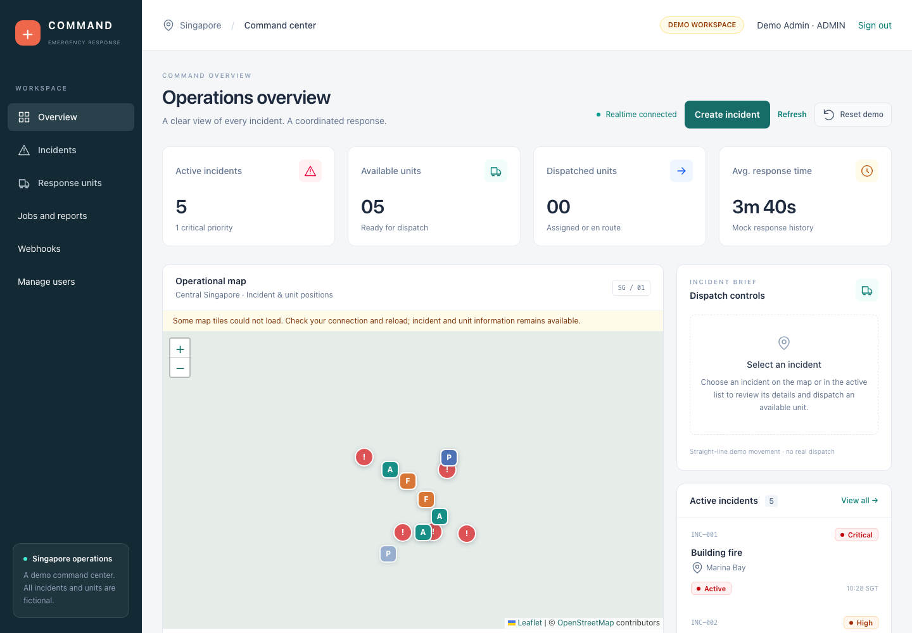
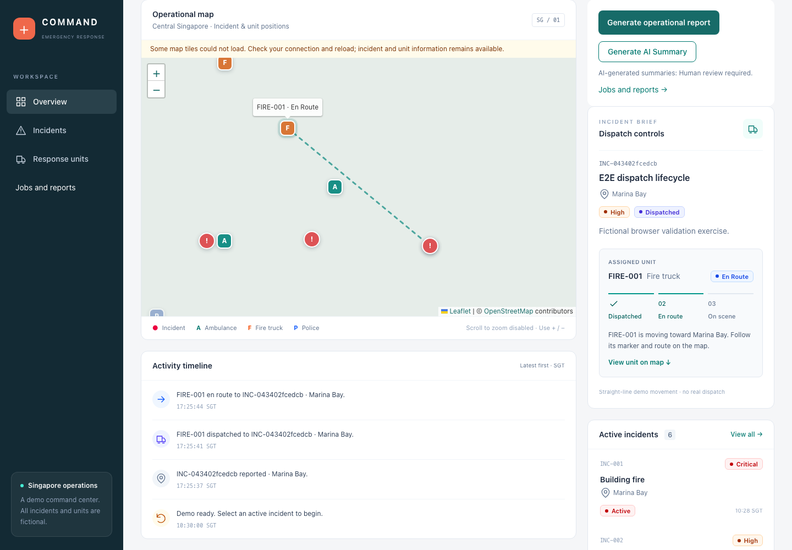
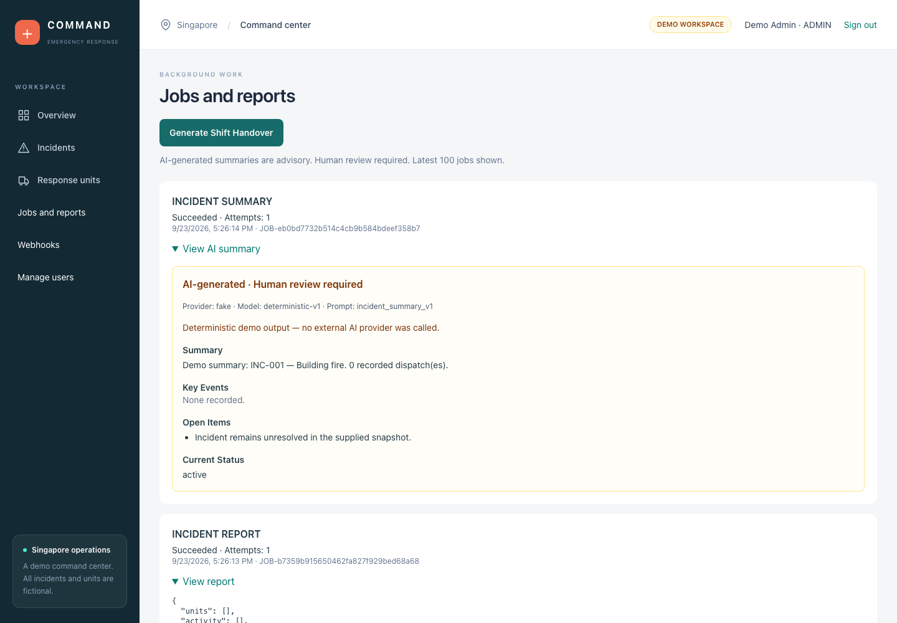

# Real-Time Emergency Response Command Platform

A full-stack command dashboard that models how dispatchers coordinate incidents,
response units and follow-up work. Its engineering focus is correctness across
transactions, realtime updates, tenant boundaries and asynchronous integrations.

**React + TypeScript · FastAPI · PostgreSQL/PostGIS · REST + WebSocket · Redis/Celery**

The application combines multi-tenant SaaS authentication/RBAC, transactional
geospatial dispatch, persistent background jobs, a durable webhook outbox,
signed HTTP delivery and advisory AI workflows. Docker Compose, automated tests,
PR CI, observability and Terraform document how the system is operated and tested.

**Fictional portfolio/demo system — not for real emergency operations.**
AWS architecture is prepared but **not deployed**. A real external LLM provider
has **not been validated**; `FakeLLMProvider` provides deterministic workflow
validation through the real queue, worker, persistence and UI.

[Five-minute demo](docs/demo.md) · [System design](docs/system-design.md) ·
[Measured facts](docs/project-facts.md) · [Interview guide](docs/interview-guide.md)

## See the workflow







The [seven-screen walkthrough](docs/screenshots/) also covers login, activity,
background jobs and signed webhook delivery. Screenshots use fictional Singapore
data. OpenStreetMap tiles were unavailable during capture, so the map shows its
real Leaflet overlays and vehicle route on a neutral background.

## Run locally

Requirements: Docker Compose, Python 3.14+, Node.js 24 LTS/npm and `make`.

```bash
git clone https://github.com/pengpeichiun-coder/realtime_emergency_platform.git
cd realtime_emergency_platform
make setup                 # generate an ignored local .env; install dev dependencies
make up                    # build and start the application stack
make seed                  # explicitly add fictional demo users and data
make smoke                 # check migrations, PostGIS, Redis, worker and UI
```

Open <http://127.0.0.1:8080/login> and use the development-only credentials in the
[demo guide](docs/demo.md). Select `INC-001`, dispatch `FIRE-001`, watch movement,
resolve the incident, then generate an operational report and AI summary.
**Jobs and reports** shows persisted job states and results. ADMIN can configure
**Webhooks**; `make webhook-smoke` proves a real signed local HTTP delivery and
500→200 retry.

Swagger is available at <http://127.0.0.1:8080/docs>. `make up-distributed` adds a
second API replica for realtime fanout validation. `make down` stops this Compose
project and preserves its PostgreSQL volume. See [container setup](docs/containers.md)
for ports, prerequisites and service boundaries.

Optional monitoring: `make monitoring-up` starts local Prometheus, Alertmanager
and a test receiver. `make monitoring-validate` checks the rules/configuration;
`make alert-rehearsal` exercises firing and resolved notifications in an isolated
stack. See the [runbook](docs/operations.md#optional-local-monitoring-and-alert-routing).
No production notification receiver is configured.

## Engineering highlights

| Area | Implementation and trade-off |
| --- | --- |
| Data correctness | PostgreSQL transactions, tenant-scoped composite constraints and partial unique indexes prevent conflicting active dispatches. PostGIS geography/GiST queries rank nearby available units. |
| Realtime | Authenticated tenant WebSockets, shared database stream cursors and Redis fanout; clients recover gaps with REST snapshots. Pub/Sub is best-effort, not durable replay. |
| Identity | Argon2id passwords, short-lived JWTs, rotating opaque HttpOnly refresh cookies and server-enforced ADMIN/DISPATCHER/RESPONDER permissions. |
| Background work | PostgreSQL job state, a standalone recovery publisher and real Redis-backed Celery tasks; bounded retry and idempotency protect durable results. |
| Integrations | Transactional outbox, encrypted show-once webhook secrets, timestamped HMAC-SHA256 signatures, DNS-pinned SSRF checks and delivery history. |
| Advisory AI | Provider interface, versioned prompts, structured validation and human-review labels. AI cannot mutate operational state or invoke tools. |
| Operations | Docker, health/readiness, protected metrics, structured logs, queue telemetry, alert rules, recovery/backup tools and tested AWS/Terraform architecture. |

## Documentation

- [Architecture](docs/architecture.md), [system design](docs/system-design.md) and [decisions](docs/decisions.md)
- [Demo](docs/demo.md), [recruiter walkthrough](docs/recruiter-demo.md), [portfolio summary](docs/portfolio-summary.md) and [interview guide](docs/interview-guide.md)
- [Project facts](docs/project-facts.md) and [validation scope](docs/validation.md)
- [Security](docs/security.md), [operations](docs/operations.md) and [public repository privacy checks](docs/public-readiness.md)
- [Background jobs](docs/background-jobs.md), [webhooks](docs/webhooks.md) and [AI workflows](docs/ai-workflows.md)
- [PR CI and dependency maintenance](docs/ci.md)
- [Production environment contract](docs/production-environment.md), [AWS architecture](docs/aws-deployment.md) and [deployment prerequisites](docs/aws-deployment-gate.md)
- [Generated OpenAPI snapshot](docs/api/openapi-v1.0.0.json)

## Validation

```bash
make test                  # backend and frontend suites
make test-postgres         # real PostgreSQL/PostGIS subset
make lint
make build
make api-docs-check
make public-readiness      # tracked-file privacy, links and Git secrets; needs Gitleaks
make system-smoke          # real HTTP, WebSocket and worker path
make distributed-smoke     # two-API fanout; start with make up-distributed
make webhook-smoke
make e2e                   # isolated real-service Chromium journey
make release-check         # local app, browser, image security and Terraform gates
```

PostgreSQL tests require a disposable `TEST_DATABASE_URL` ending in `_test`;
they reset test tenants. Never use a database containing wanted data.
[CI](docs/ci.md) provisions isolated services and runs the same gates without
production credentials. Ordinary `main` pushes do not trigger validation; PRs
and manual dispatch do.

## Scope and limits

This is a modular monolith. PostgreSQL owns business state; Redis carries messages
and realtime fanout. There is no PostgreSQL row-level security, durable WebSocket
replay, automatic retention/key rotation or cross-tab refresh lock. External calls
are at-least-once; webhook receivers must deduplicate delivery IDs. Redis-outage
auth limiting falls back per process. No production uptime, capacity or external
LLM quality claim is made. Cloud deployment needs separate account, domain,
secrets and cost approval.

No explicit software license is currently provided.
