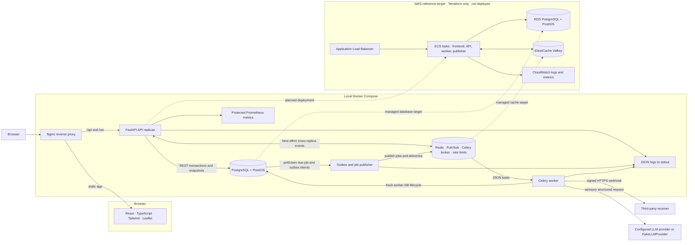

# Current system architecture

This is the canonical diagram for the current application. It shows the
local Compose topology plus the proposed AWS target; the AWS target is not
deployed. Detailed flow and failure contracts are in [system design](system-design.md).

## Responsibilities

PostgreSQL is the durable operational source of truth. The repository maps records
to existing domain dataclasses, keeping geography, organization keys, and sessions
out of REST and WebSocket payloads. FastAPI services retain transition validation,
assignment rules, semantic activity creation, and simulation orchestration. Routes
remain adapters. The memory repository is explicitly injected only by fast tests;
there is no runtime fallback and no second set of business rules.

An application owns one engine/session factory; each service operation enters a
fresh repository transaction and closes its session before returning. A ContextVar
passes that session through repository helpers only within the operation. A task
is started after transaction exit, so it does not inherit a live session. Shutdown
cancels tracked simulation tasks, cleans up sockets, and disposes the engine.

## Relational model

- `organizations`: organization ID, name, UTC creation/update timestamps.
- `users`: global normalized unique email, organization FK, Argon2id password hash,
  role, active flag and UTC timestamps.
- `refresh_tokens`: user FK, unique SHA-256 token hash, expiry/revocation/creation
  timestamps and a replacement-token self FK.
- `incidents`: organization + incident ID composite key, metadata/status,
  geography, optional assigned unit, timestamps including resolution.
- `units`: organization + unit ID composite key, metadata/status, geography,
  optional assigned incident, creation/update/location timestamps.
- `dispatches`: organization + dispatch ID composite key, same-organization
  incident/unit foreign keys, status, original coordinates and lifecycle times.
- `activity_logs`: organization + activity ID composite key, semantic event,
  entity ID/type, message, JSONB metadata, and UTC timestamp.

Composite foreign keys prevent an assignment from linking different organizations.
Incident/unit assignment references are deferred until commit, permitting their
atomic updates and seed/reset ordering. IDs may be reused in different
organizations. RequestContext selects repository scope from the current database
identity; known cross-tenant IDs return 404. ORG-DEMO is only a development seed.

Statuses use CHECK-constrained strings compatible with existing lowercase API
values. The Python Literal types and transition functions still define behavior.
Strings avoid PostgreSQL enum replacement complexity in later migrations.
Timestamps use TIMESTAMPTZ; domain timestamps are timezone-aware UTC.

## Why PostgreSQL and transactions

Incidents, units, dispatches, and activity must commit together. Each mutating
operation first locks its organization row, then locks affected records with
`SELECT ... FOR UPDATE`. This establishes a shared lock order across independent
service instances, including reset. Availability/state is checked only after
locks are held. A second dispatcher waits, then sees the committed assignment and
receives a conflict.

Two partial unique indexes additionally enforce one non-completed dispatch per
organization/unit and organization/incident, including on-scene assignments.
These protect the database even if a writer bypasses the service. All changes,
including activity, roll back on failure. Integrity conflicts become HTTP 409.

The organization lock deliberately serializes writes within the small demo. It
simplifies reset and deadlock handling, but is a throughput limitation. Reads use
short REPEATABLE READ, READ ONLY transactions so a multi-query snapshot is
consistent. The application lock orders snapshots and events inside one process;
database locks, not the application lock, protect dispatch against other sessions.

## Why PostGIS

Incident and unit locations are `GEOGRAPHY(Point, 4326)` with GiST indexes.
`Point(longitude, latitude)` conversion is isolated in `app/db/geo.py` and tested.
The wire format still exposes numeric `latitude` and `longitude`.

Nearby lookup joins the scoped incident to available, unassigned units, excludes
units with active dispatches, applies `ST_DWithin`, and orders by `ST_Distance`
then unit ID. Geography distances are meters. Defaults: 10 km and 10 units;
maximums: 50 km and 50 units. Distance is straight-line geographic distance, not
road travel time. No list of locations is loaded into Python to calculate distance.

## Event consistency

Services buffer fully validated events and simulator starts inside the operation.
Only a successful repository transaction releases them to the Redis backplane.
Rollback discards them and restores the process-local sequence counter. Tests
inject commit failures and ensure neither events nor tasks escape.

Realtime fanout does not use a durable outbox (webhooks do). A process crash after database
commit but before publication can lose a delivery, though the state remains saved.
Clients recover through REST snapshots after reconnect, using the
shared PostgreSQL stream ID and sequence. Redis Pub/Sub now fans out
to all API replicas; REST snapshots remain the recovery authority.

## Simulation and restart

Each movement frame performs a short transaction updating the latest unit
location. Arrival atomically writes unit/incident/dispatch state and semantic
activity. No transaction spans the simulated trip. There is no per-frame location
history or per-frame activity log.

Startup queries committed dispatches in `created` or `en_route` and registers one
tracked task for each. A created dispatch waits only the remaining preparation
delay, then departs. An en-route dispatch resumes from its latest saved location
for the remaining travel duration, based on its UTC `started_at`. If that duration
expired during downtime, it arrives immediately. After recovery starts, movement
uses a monotonic clock. Completed/arrived dispatches are not restarted. Recovery
uses the current code timing configuration; it is a demo clock, not a routing SLA.

Shutdown cancels tasks without deleting committed state. Demo reset holds the
service lock, cancels/joins tasks, transactionally resets only the demo organization,
and broadcasts a full snapshot after commit. A failed reset rolls back and
attempts to resume the retained trips. If the database is still unavailable, the
failure is logged; restart after database recovery to resume those tasks. Movement tasks resume after API restart and do not use the business-job retry queue.

## Seed, migration, and retention

Alembic revision `0001_operational_schema` creates PostGIS, tables, constraints,
and indexes. Revision `0002_identity` adds users and refresh tokens, upgrading
the operational schema. Normal startup never migrates or seeds. The explicit seed command
creates `ORG-DEMO` if needed and seeds only an empty organization; any existing
operational data is left untouched. A short advisory lock serializes organization
creation and an organization row lock serializes the empty-state check and seed.
All fixtures originate in the existing `repositories/seed.py`.

Demo reset changes data, not schema. Migration downgrade drops application tables
but leaves the potentially shared PostGIS extension installed. Activity persists
until explicit demo reset; snapshots expose the latest 100 entries for the current
UI. Historical entries are not deleted when that display limit is reached. Retention
and paginated historical access remain an actual follow-up consideration.

## Validation boundary

Fast tests explicitly use the memory double for domain/realtime behavior. Geometry
helpers and offline migration SQL are checked without pretending to execute PostGIS.
`tests/test_postgres.py` exercises real migrations, persistence, geography, scoping,
rollback, concurrent independent services, unique indexes, reset, and recovery.
It skips without `TEST_DATABASE_URL`; connection/migration errors fail when a URL
is supplied. The target must be local, end in `_test`, and differ from the development
database even across localhost aliases or different credentials. Each case resets
the demo organization; test-created extra organizations are cleaned up. Run this
suite serially against a dedicated disposable database.

## Trusted tenant boundary

`Request → RequestContext → TenantServices.get(organization_id) → OperationsService
→ PostgresRepository(organization_id) → PostgreSQL`.

The context dependency validates Bearer JWTs and loads current active DB users,
never tenant data from a caller. Explicit server injection remains a test seam. No context means 401; known IDs belonging to another organization
return the same 404 as unknown IDs. The default app has no global demo tenant.
`ORG-DEMO` remains solely a seed/repository convenience for explicit setup/tests.

TenantServices groups sockets through one ConnectionManager per organization.
Each API process owns local sockets, locks and simulator task dictionaries;
PostgreSQL stores the shared per-organization stream ID/sequence and Redis routes
committed events between API processes. Repositories share one engine/pool but
have independent transaction ContextVars. Recovery enumerates persisted
organizations and resumes each through its own service. Reset cancels and deletes
only the active tenant's work.

Real PostgreSQL API tests exercise ORG-A and ORG-B, including guessed resource
IDs, malicious tenant selectors, activity/nearby reads, dispatches, reset, sockets,
and simultaneous organization-specific recovery. Explicit repository injection
remains a unit-test seam and cannot be configured by HTTP callers.

Identity flows, refresh cookies, centralized authorization policies and WebSocket
authentication are detailed in [security.md](security.md).

## Async business workflows — Phases 8–10

The operations simulator remains an asyncio component, with per-dispatch
PostgreSQL advisory ownership across API replicas.
Celery is used for retryable business work: deterministic incident reports,
outbound webhook delivery and advisory incident/shift summaries. Redis is the
JSON-only broker; PostgreSQL is authoritative for jobs, deliveries and results.
A standalone polling publisher recovers committed work without depending on a
request surviving its database commit. Celery Beat is not needed.

Operational mutations persist recipient-scoped outbox events atomically before
WebSocket broadcasts. Outbox materialization creates unique event/subscription
deliveries; publication and execution tolerate duplicates. This outbox serves
external integrations, not WebSocket replay. Each Celery task creates/disposes
its own async engine within its own loop, uses short database transactions, and
holds a separate PostgreSQL advisory lock to fence concurrent execution. No
request-scoped session or tenant service enters a worker.

AI providers receive only read-only tenant snapshots and versioned instructions.
Validated artifact creation and job success commit together. Provider outputs
cannot call operations or change permissions. Exact protocols, retries and
known crash windows are documented in [background jobs](background-jobs.md),
[webhooks](webhooks.md) and [AI workflows](ai-workflows.md).

Migration chain continues through `0008_queue_observability`, which adds a partial
pending-outbox index. The previous `0007_operation_retry_audits` records
ADMIN-requested job and webhook retries in a tenant-scoped audit table.
Publisher heartbeat lives in Redis, not a new database table. Docker/CI and AWS deployment preparation are described
in [container topology](containers.md), [CI](ci.md) and [AWS deployment](aws-deployment.md);
AWS resources are not provisioned. Redis Pub/Sub remains best-effort and REST
snapshots remain the recovery authority.

## container boundary

Compose runs the existing monolith API, business worker and publisher with private
PostGIS/Redis services and a shared reusable backend image. A separate one-shot
migration gates startup. Non-root Nginx serves static assets and proxies same-origin
REST/WebSocket traffic. Named PostgreSQL volume preserves state across down/up;
Redis is disposable because business intents remain durable in PostgreSQL.
See [container topology and validation](containers.md).

## Multiple API instances

Redis now provides tenant-routed fanout across APIs; PostgreSQL stores the shared
stream cursor. Advisory dispatch ownership avoids duplicate demo movement during
normal concurrent API operation. See [realtime and observability](realtime-observability.md)
for failure/resync semantics, instrumentation and measured local load results.
